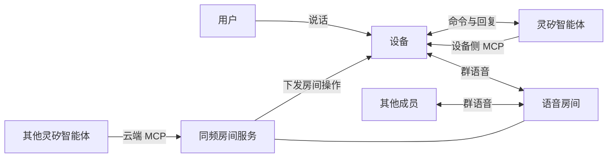

# 灵矽同频

[](https://github.com/Shi1xin/linx-intercom/actions/workflows/test.yml)

给灵矽平台加上多人实时语音房间。对设备说一句话就能新建房间、用邀请码加入、按名字切换，房间成员之间全双工通话；其他灵矽智能体也能通过云端工具把设备拉进房间


## 架构设计

智能体负责控制，房间服务负责媒体。用户的命令经灵矽智能体变成工具调用，群语音经 WebRTC 直连语音房间并在服务端混音



接入全部使用灵矽已有的扩展点，平台侧零改动：

- **设备侧 MCP** `self.intercom.*`：设备绑定的智能体发现并调用，用户对设备说话即可操作房间
- **云端 MCP** `intercom.*`：任意灵矽智能体配置同频服务后，可远程让指定设备入房、切房、退出
- **mcpproxy 反向通道**：同频服务主动连出注册云端工具，部署时无需公网入口

## 使用

设备平时是灵矽助手。进入房间后，直接开口是对全房间说话；按住 BOOT 或说「你好小智」是对智能体说话，这时房间上行暂停、房间声音继续播放

| 操作 | 说法 |
| --- | --- |
| 新建房间 | 「新建一个对讲房间」，智能体念出房间名和邀请码 |
| 加入房间 | 「加入对讲房间，邀请码七二三八二七」 |
| 切换房间 | 「切换到二号房」，限已加入过的房间 |
| 查询 | 「我在哪个房间」「房间邀请码是什么」 |
| 静音 | 双击 BOOT，或说「静音」「恢复通话」 |
| 退出 | 「退出对讲房间」，回到灵矽助手 |

断线或断电重启后，设备自动回到最后所在的房间。另一个灵矽智能体调用云端工具把设备移到别的房间时，设备会本地播报去了哪里

## 完成度

- 语音新建、加入、切换、查询、静音、退出：真机与真实灵矽平台实测
- 云端智能体接管：真实灵矽平台经 mcpproxy 调用，真机执行
- 断线与重启自动回房：真机实测，单成员房间连续 30 分钟保持
- NFC 碰一碰组队：服务端与固件执行链完成，经 `op:nfc` 注入验证，读卡器待接
- 第二台设备由浏览器端代替；回声消除待接入

设计思路见 [产品设计](docs/product-design.md)，实现细节见 [产品架构](docs/architecture-design.md) 与 [控制协议](docs/control-protocol.md)

## 构建与运行

```bash
cd server && go build -o bin/intercom-server ./cmd/intercom-server && cd ..
./server/bin/intercom-server -addr :8090 -janus ws://<janus>:8188 -device-token dev -admin-token <secret>
```

浏览器端 `http://<server>:8090/?dev=<MAC>`。固件：`cd firmware/intercom && idf.py -p <port> build flash`。配置、部署与免硬件复现见 [使用说明](docs/usage.md)

灵矽侧接入：设备侧 `self.intercom.*` 随会话 hello 的 `features.mcp` 声明自动开放，平台无需配置。云端 `intercom.*` 在灵矽控制台新建 SSE 类型 MCP（地址 `https://<灵矽平台>/v1/mcpproxy/mcp`，请求头 `X-MCP-Token: <token>`），再用同一 token 运行 `mcpbridge -endpoint 'wss://<灵矽平台>/v1/mcpproxy/connect?token=<token>' -server http://<server>:8090 -target <设备MAC> -admin-token <secret>` 连出注册，最后把该 MCP 挂到要接管设备的智能体上

测试：

```bash
(cd server && go test ./internal/server/...)
node --test tools/browser/client.test.mjs
(cd firmware/intercom && python3 -m unittest discover tests)
```

## 目录结构

| 路径 | 内容 |
| --- | --- |
| `server/` | 房间服务：房间、成员、操作投递、云端 MCP、状态查询 |
| `firmware/intercom/` | 设备固件：灵矽接入、音频链路、房间状态机、本地播报 |
| `tools/browser/` | 浏览器端与协议回归测试 |
| `tools/softdev/` | 无硬件的软件设备 |
| `tools/wsprobe/` | 协议与媒体探针 |
| `tools/mcpbridge/` | 平台 mcpproxy 到房间服务的调用桥 |
| `tools/announce/` | 本地播报片段生成 |
| `tools/turnsrv/` | TURN 中继 |
| `infra/` | 部署与测试环境 |
| `docs/` | 产品、架构、协议、使用文档 |
