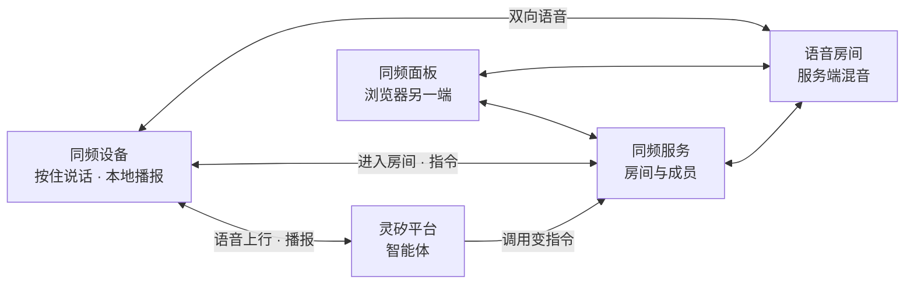

# 灵矽同频

[](https://github.com/Shi1xin/linx-intercom/actions/workflows/test.yml)

为灵矽平台扩展群对讲能力的服务端、MCP 工具与设备固件。设备在同一条语音链路里切换两路对话——跟灵矽智能体说，跟房间全队说。

主页 https://lingxiwmp.qiniu.com/intercom/

## 产品特性

- 两条控制通道驱动同一房间：对设备说话由灵矽智能体转成执行调用，云端与管理入口下发同样的指令
- 播报的就是设备实际状态：调用在媒体确认后才返回结果，失败如实说明
- 房间持久存在：设备记住加入过的房间，断电重启自动回去
- 断线自愈：会话断开自动重连，长回复连续播放，进出房间有本地提示音

## 系统架构



NFC 组队当前经服务端注入演示，物理读卡器在后续方向。

设计与协议细节见 [产品设计](docs/product-design.md)、[控制协议](docs/control-protocol.md)、[产品架构](docs/architecture-design.md)。

## 验证与测试

以下结果在真实平台与真实硬件上录得：

- 多轮智能体会话，播报与设备实际状态一致
- 云端接管全链实测：进房、切房、静音、退出
- 断线重连后自动回到房间，长回复整段播放连续
- 单成员房间 30 分钟保持无异常

软件回归：

```bash
(cd server && go test ./internal/server/...)
node --test tools/browser/client.test.mjs
(cd firmware/intercom && python3 -m unittest discover tests)
```

## 构建与运行

```bash
cd server && go build -o bin/intercom-server ./cmd/intercom-server && cd ..
./server/bin/intercom-server -addr :8090 -janus ws://<janus>:8188 -device-token dev -admin-token <secret>
```

浏览器面板 `http://<server>:8090/?dev=<MAC>`。固件：`cd firmware/intercom && idf.py -p <port> build flash`。

操作与部署细节见 [使用说明](docs/usage.md)。

## 目录结构

| 路径 | 内容 |
| --- | --- |
| `server/` | 同频服务：房间、成员、指令投递、状态查询 |
| `firmware/intercom/` | 设备固件：音频链路、房间状态机、本地播报 |
| `tools/browser/` | 同频面板与协议回归测试 |
| `tools/softdev/` | 无硬件的软件设备 |
| `tools/wsprobe/` | 协议与媒体探针 |
| `tools/mcpbridge/` | 平台到服务的调用桥 |
| `tools/announce/` | 播报片段生成 |
| `tools/turnsrv/` | 中继服务 |
| `infra/` | 部署与测试环境 |
| `docs/` | 产品、协议、使用文档 |

## 后续方向

NFC 物理读卡器、回声消除、App 设备页、固件 OTA。详见 [产品设计](docs/product-design.md#后续方向)。
