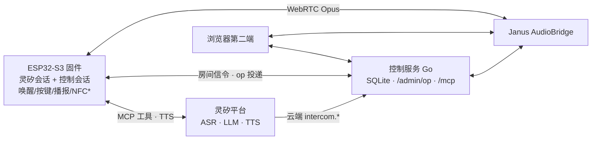

# 灵矽同频

[](https://github.com/Shi1xin/linx-intercom/actions/workflows/test.yml)

接入灵矽平台的群语音对讲系统：ESP32-S3 设备承载灵矽智能体，说出邀请码或房间名即可进入持久语音房间，多端全双工通话，退出后回到智能体对话。灵矽平台经一条 WebSocket 提供 ASR/LLM/TTS 会话与 MCP 工具协议，固件把房间操作注册为智能体可调用的工具。

ESP32-S3 group voice intercom on the Linx agent platform: speak a room name or invite code to join a persistent voice room; the device-side agent and the cloud drive the same room through one execution path.

## 与语音助手的差别

| 能力 | 说明 |
| --- | --- |
| 云端与设备端同时可控同一房间 | 对设备说话、对另一端的智能体说话、`POST /admin/op`，三条入口驱动同一个房间执行器与状态机 |
| 工具调用结果如实播报 | MCP 工具结果在房间媒体确认后才返回，携带真实房间名/邀请码/在线数/静音态；智能体播报的就是设备实际状态，失败明确说未完成及原因 |
| 多入口同一执行链 | 唤醒词、按住命令键、云端 MCP、召唤（服务端建房并通知目标设备入房）、NFC 注入、断线恢复全部汇入同一组房间操作，行为与幂等语义一致 |
| 平台会话僵死自愈 | 半开 TCP 靠发送失败判据立即下线重连；TTS 回合看门狗（首帧 25 s/帧间 5 s）超时自愈；串口实测恢复后继续可用 |
| TTS 抖动缓冲 | 平台按句子突发下发音频（句间停顿可达秒级）；150 帧抖动缓冲 + 欠载后重新蓄势，长回复播放连续 |
| 本地播报仲裁 | 云端/NFC 触发的房间变化由设备内置片段播报房间名；设备自己语音触发时让位给智能体 TTS，双通道重复播放由仲裁位消除 |

## 架构

设备固件同时持有两条 WebSocket：灵矽平台会话（ASR/LLM/TTS + 设备侧 MCP 工具 `self.intercom.*`）与同频控制会话（房间信令、操作投递）。群语音走设备与 Janus AudioBridge 的 WebRTC 通道，服务端混音。任一控制连接中断时另一条继续工作。



*NFC：标签绑定与入房执行链已通（服务端解析标签 → 建房/入房，固件走同一事件路径），当前由服务端 `op:nfc` 注入触发；物理读卡器在展望。

完整架构与决策依据见 [产品设计](docs/product-design.md)，协议格式见 [控制协议](docs/control-protocol.md)，技术附录见 [产品架构](docs/architecture-design.md)。

## 验证证据

真实平台 + 真实硬件记录（演示智能体 + 面包板 + 浏览器对端 + Janus）：

- 8/8 轮真实智能体会话回复与设备实际状态一致，含无效邀请码的明确失败回复
- `/admin/op` 直连下投：入房、状态、静音、切房、切回（静音保持）、退出，各次本地播报片段齐全
- 云端接管经平台反向 MCP 通道：智能体调用 `intercom.*` 改变面包板房间状态
- 平台会话半开断连复现修复：发送失败立即下线，5 秒重连恢复
- TTS 长回复 500 帧整段播放：0 丢帧，欠载仅落在句间边界
- 30 分钟单成员房内保持、正常关闭恢复、重复平台重连零采集丢样

覆盖边界：`SELFTEST_TEXT` 自检与 `softdev` 脚本走文本注入，覆盖平台智能体、工具协议与 TTS；真机麦克风采集、唤醒词检测、物理按键与通话听感属人工验收项。

软件回归（与 CI 相同的三条命令，各自在子 shell 中执行）：

```bash
(cd server && go test ./internal/server/...)          # 17 项：协议/状态机/MCP/token 认证
node --test tools/browser/client.test.mjs            # 5/5：浏览器端协议与切房回归
(cd firmware/intercom && python3 -m unittest discover tests)   # 38 项：固件逻辑桩 + 源码守卫检查
```

无硬件时运行这三条即可验证协议、状态机与固件逻辑；浏览器页与 wsprobe 的媒体链路需要真实 Janus。

## 运行

服务端（从仓库根启动，`/` 路径伺服浏览器端页面）：

```bash
cd server && go build -o bin/intercom-server ./cmd/intercom-server && cd ..
./server/bin/intercom-server -addr :8090 -janus ws://<janus>:8188 -device-token dev -admin-token <secret>
```

浏览器第二端：`http://<server>:8090/`（真麦克风需 localhost 隧道或 HTTPS）。设备状态面板 `?dev=<MAC>`。

固件：ESP-IDF 5.5，`cd firmware/intercom && idf.py set-target esp32s3 && idf.py -p <port> build flash`。

使用者操作、开发者构建参数、注入测试路径与演示脚本见 [使用说明](docs/usage.md)。产品主页：[landing/](landing/index.html)。

## 组件地图

| 路径 | 内容 |
| --- | --- |
| `server/` | Go 控制服务：房间/邀请码/成员/恢复目标、Janus 适配、MCP 云端适配、`/admin/op`、`/state` |
| `firmware/intercom/` | ESP32-S3 固件：音频链路、唤醒词、双连接会话、房间状态机、播放仲裁、本地播报 |
| `tools/browser/` | 浏览器第二端与设备状态面板 + 协议回归测试 |
| `tools/softdev/` | 软件设备：无硬件跑平台会话与真实房间操作 |
| `tools/wsprobe/` | 控制协议 + WebRTC 媒体探针 |
| `tools/mcpbridge/` | 平台 mcpproxy 反向通道 → `/admin/op` 桥 |
| `tools/announce/` | 本地播报片段生成 |
| `tools/turnsrv/` | TURN 中继 |
| `infra/` | Janus 测试环境与部署配置 |
| `docs/` | 产品设计、控制协议、使用说明、架构附录 |

## 展望

NFC 物理读卡器、AEC 回声消除、App 设备页、多板型与固件 OTA 发布；详见 [产品设计 · 展望](docs/product-design.md#展望)。
