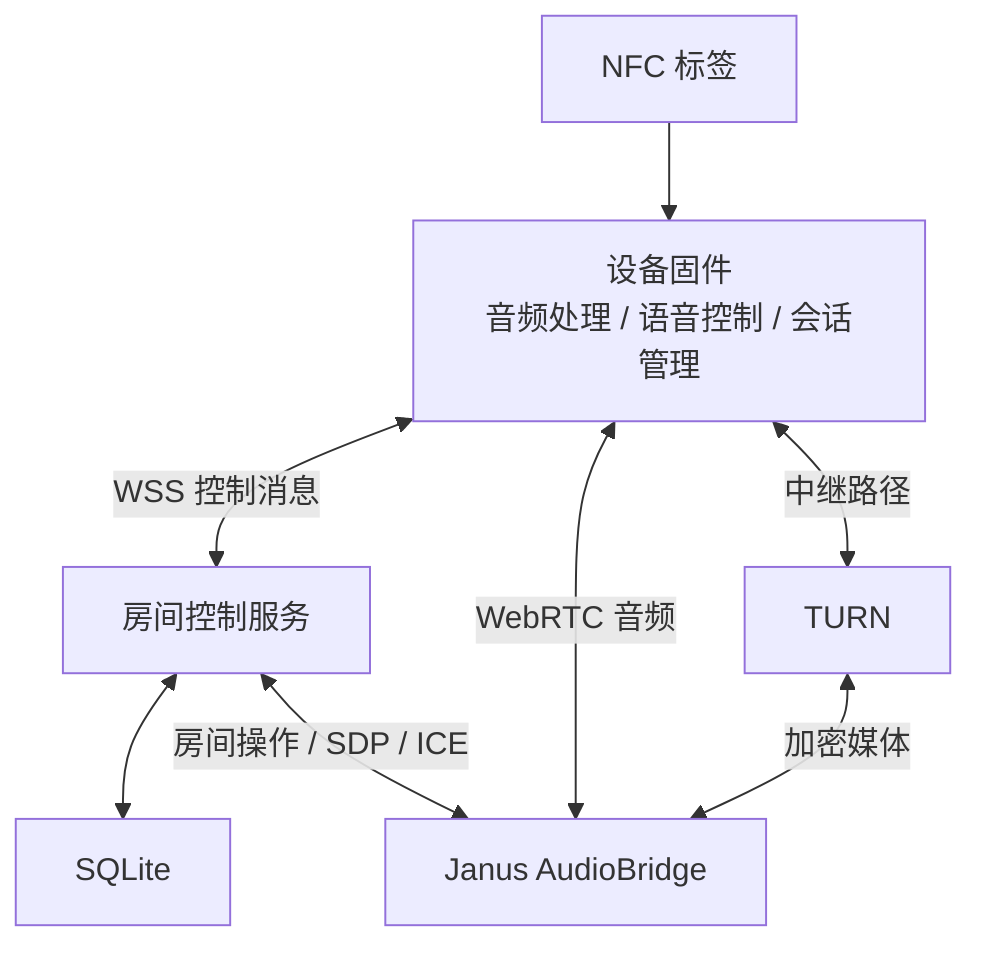
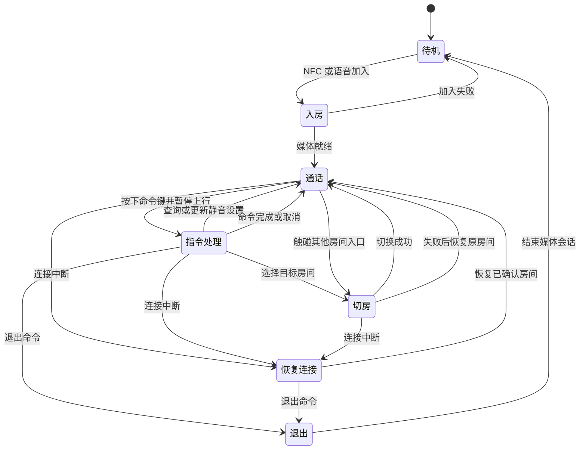
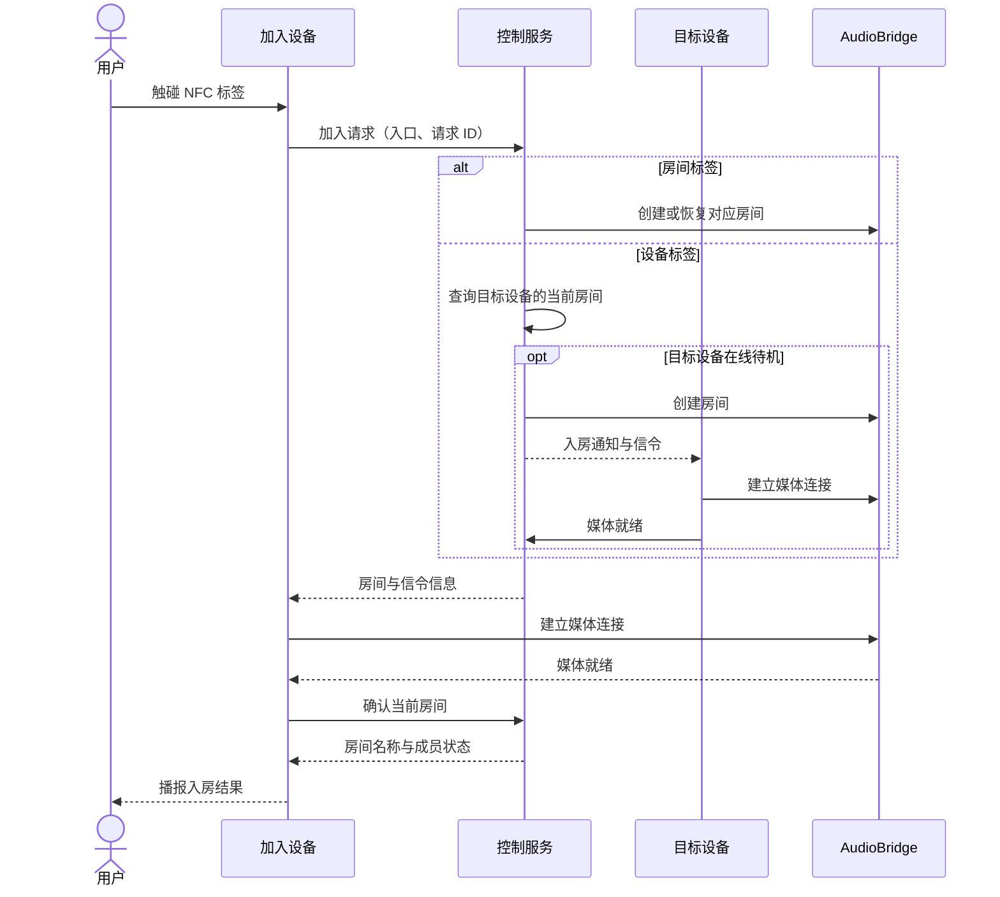
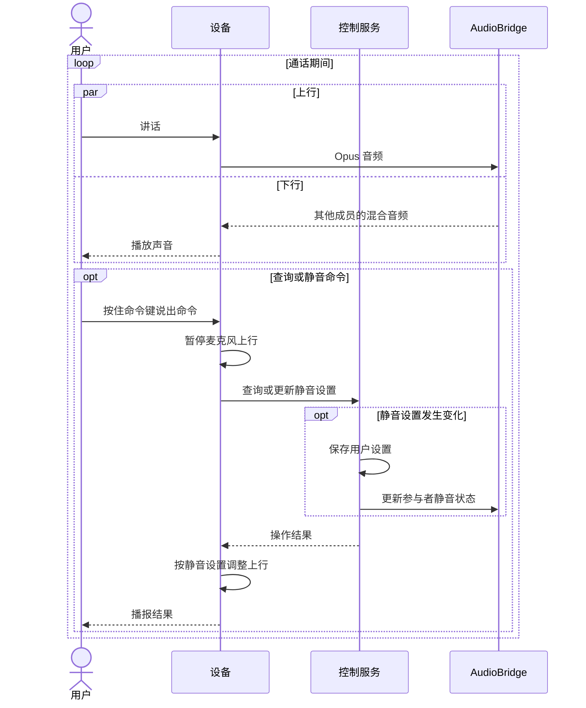
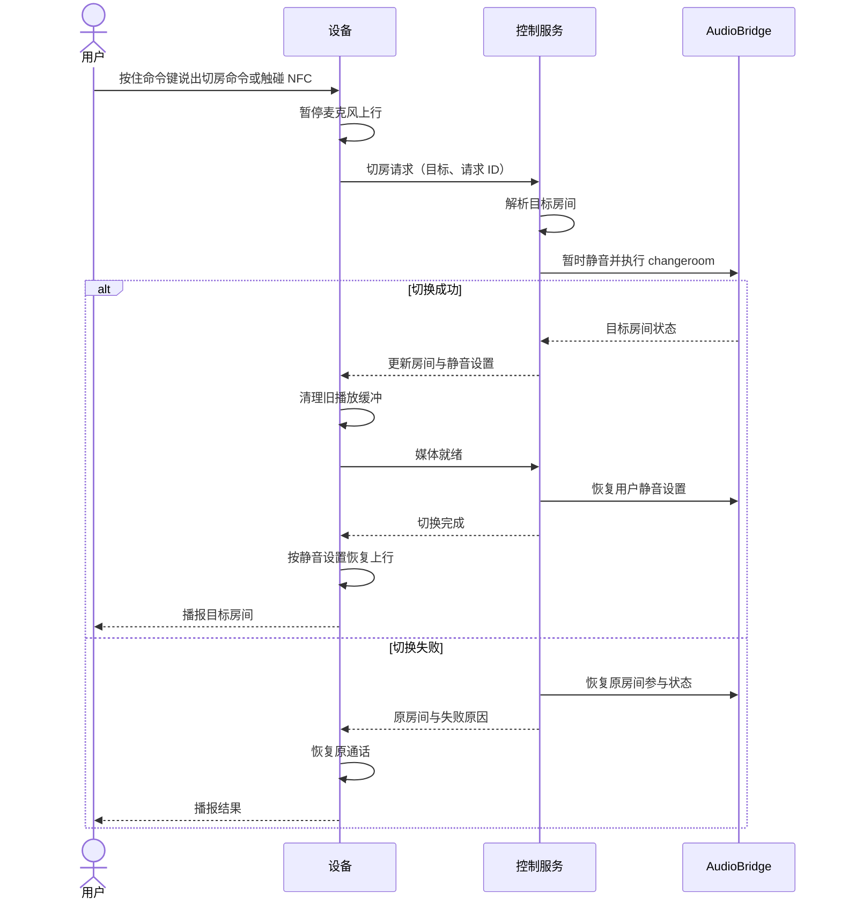
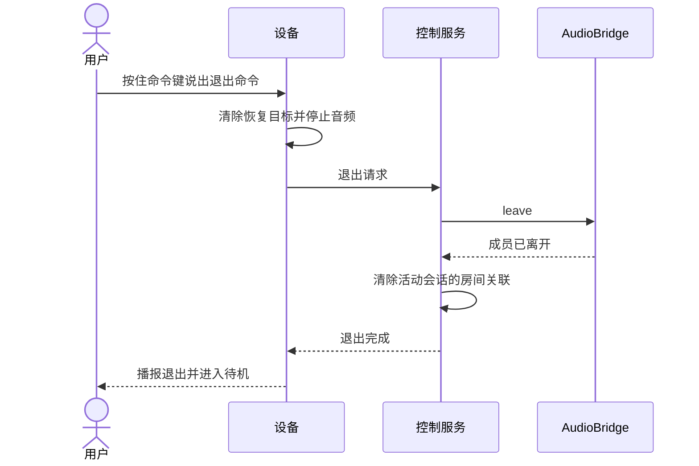
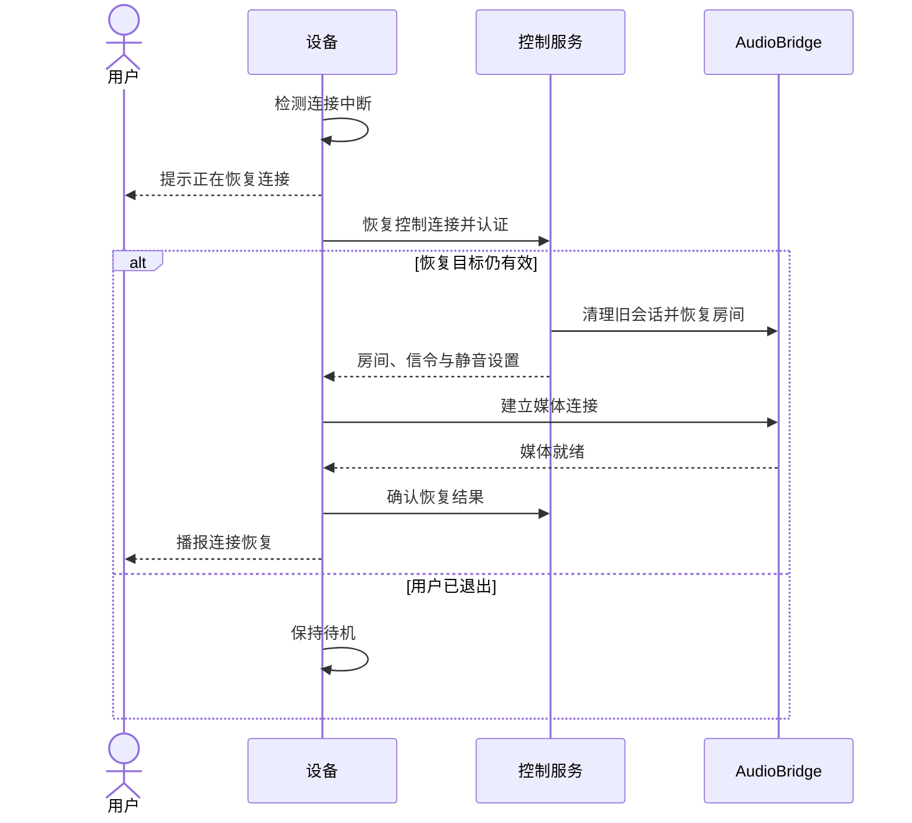

# 产品架构

## 系统架构

设备固件基于 [ESP-IDF](https://github.com/espressif/esp-idf) 和 [ESP-WebRTC](https://github.com/espressif/esp-webrtc-solution)，完成音频处理、实时通信、NFC 读取和语音控制。房间控制服务使用 Go，SQLite 保存设备、标签和房间关系

音频服务采用 [Janus AudioBridge](https://janus.conf.meetecho.com/docs/audiobridge.html)，在服务器端混合成员声音。每个终端通过一个 WebRTC PeerConnection 上传自己的音频，接收其他成员的混合音频，支持同时发话和收听

控制服务认证设备身份、解析 NFC 入口、维护房间与成员关系，并转发 Janus 信令。设备通过 IP 网络连接服务，TURN 在媒体路径需要中继时转送加密音频

设备上行经过采集、回声消除、降噪和 Opus 编码，下行经过解码和播放。扬声器播放信号作为回声消除参考，覆盖通话声音和设备提示音。语音活动检测用于静音抑制

语音控制从按下命令键开始，松开命令键结束识别。进入指令处理时，设备暂停麦克风上行并继续播放房间声音；操作完成后，按会话状态和静音设置恢复音频。提示使用预录音或 TTS

## 数据模型

- **Device**：以固定 MAC 地址作为 `device_id`，保存认证凭据、静音设置和连接恢复目标。MAC 用于定位设备，凭据用于认证
- **NFCEntry**：以标签标识作为 `entry_id`，记录入口类型及目标。房间入口指向 `room_id`；设备入口指向目标设备的 MAC。设备标签也可直接携带 MAC 内容
- **Room**：保存 `room_id`、可播报名称及 Janus 房间映射
- **Membership**：保存设备与已加入房间的关系，用于语音再次进入
- **Session**：维护连接状态、当前房间、目标房间和当前操作的 `request_id`

标签标识保持唯一，设备与房间的成员关系保持唯一。首次读取房间标签时原子创建标签映射和房间；重复请求返回同一结果

设备在媒体就绪后确认当前房间，并保存连接恢复目标。切房过程中保留原房间作为失败恢复目标；主动退出清除连接恢复目标，保留已加入记录

会话操作携带请求 ID，设备仅应用当前操作对应的响应。房间映射持久化保存，空房间释放媒体资源，再次加入时恢复

## 状态机

静音是独立于会话状态的用户设置。指令处理和切房临时暂停上行，保持静音设置；恢复连接使用最近一次确认的房间。主动退出优先清除恢复目标，使后续连接事件保持待机意图

## 交互时序

### 组队

NFC 请求经控制服务解析为目标房间。控制服务协调 SDP 和 ICE，设备与音频服务建立媒体连接；媒体就绪后提交成员状态并播报结果

目标设备离线或入口解析失败时，控制服务返回对应结果，设备保持原会话状态。对同一入口的重复接触由设备去重，服务端按请求 ID 保证幂等

### 通话

上行和下行同时进行。AudioBridge 为每位接收者混合其他成员的声音；设备语音命令通过控制通道处理

### 房间切换

控制服务解析语音目标或 NFC 入口，使用 AudioBridge 的 `changeroom` 操作切换房间。设备沿用媒体连接，清理原房间的播放缓冲，并恢复用户的静音设置

### 退出

设备先清除连接恢复目标并停止音频，再结束服务端会话。已加入房间记录保留，用于后续再次进入

控制连接中断时，设备仍执行本地退出；服务端在会话失效后回收对应媒体资源

### 连接恢复

设备保存最近一次确认的房间和静音设置。连接恢复时重新认证，协调媒体连接，并在音频就绪后恢复通话

