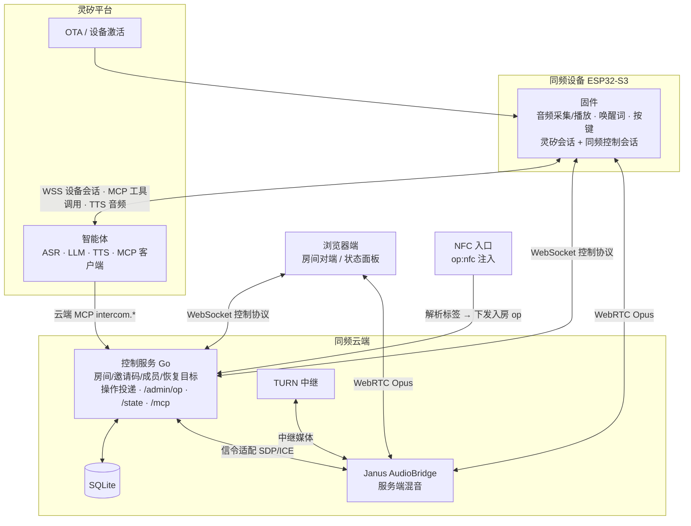
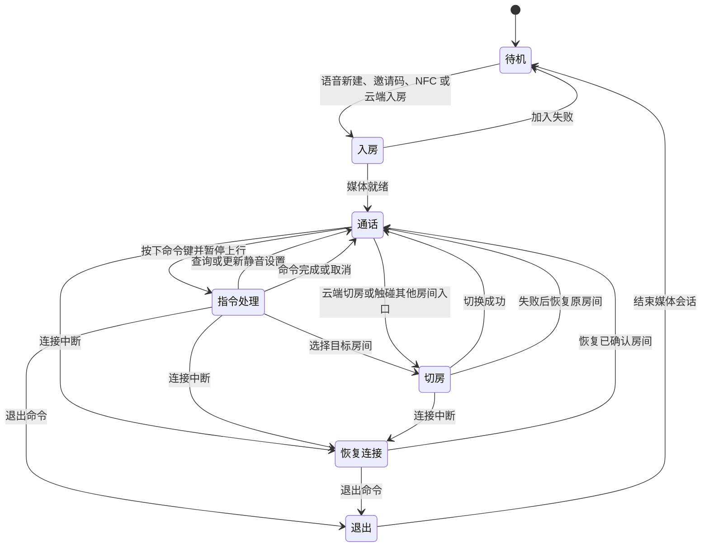
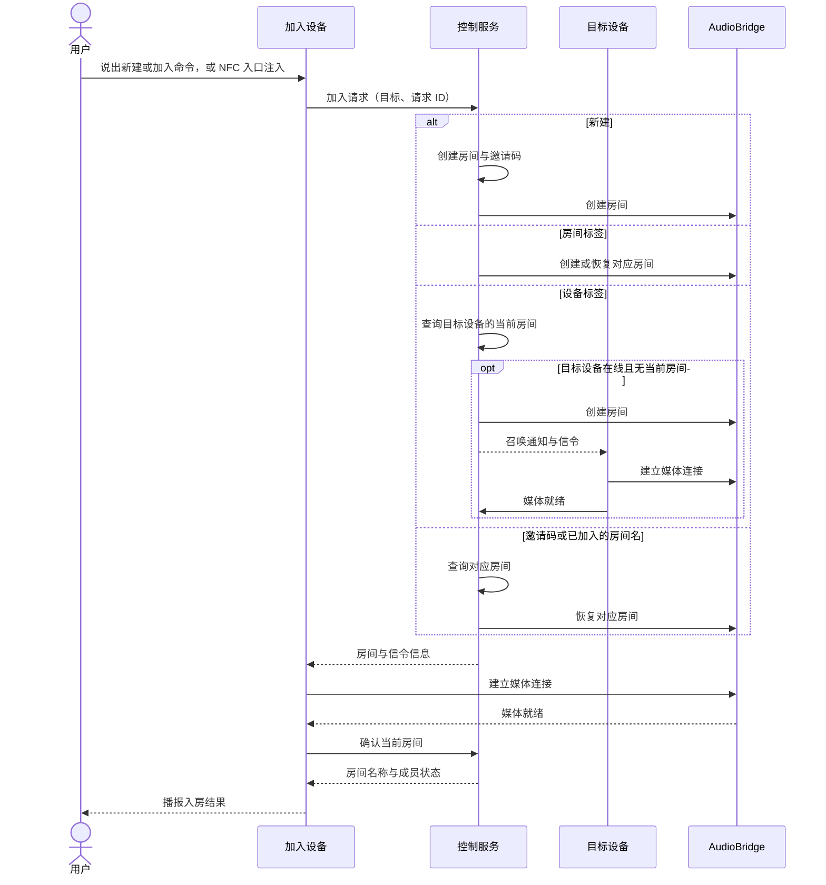
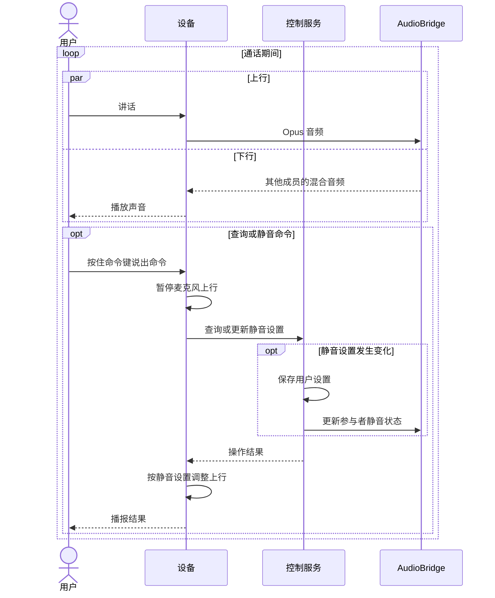
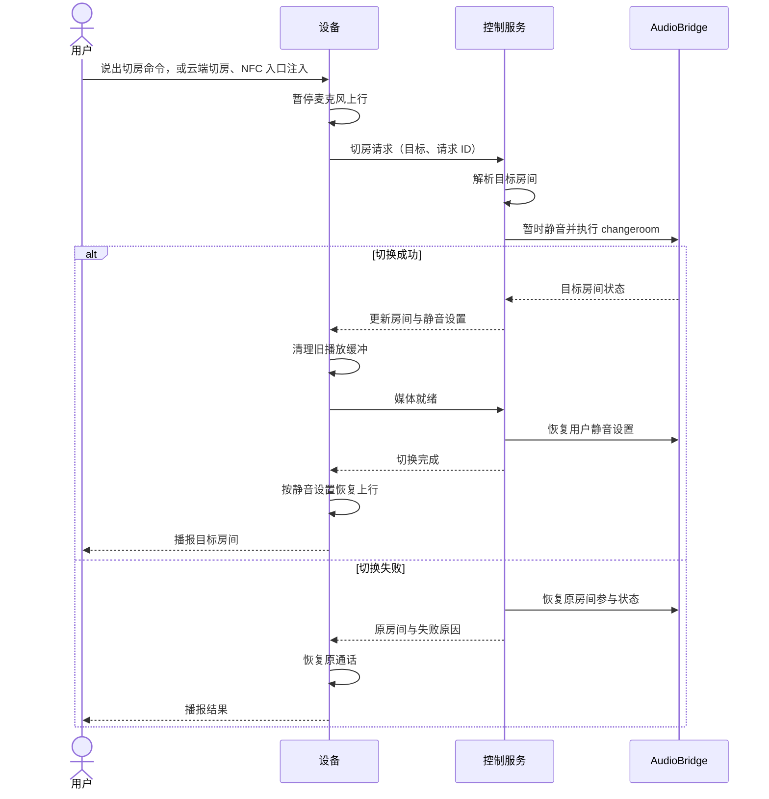
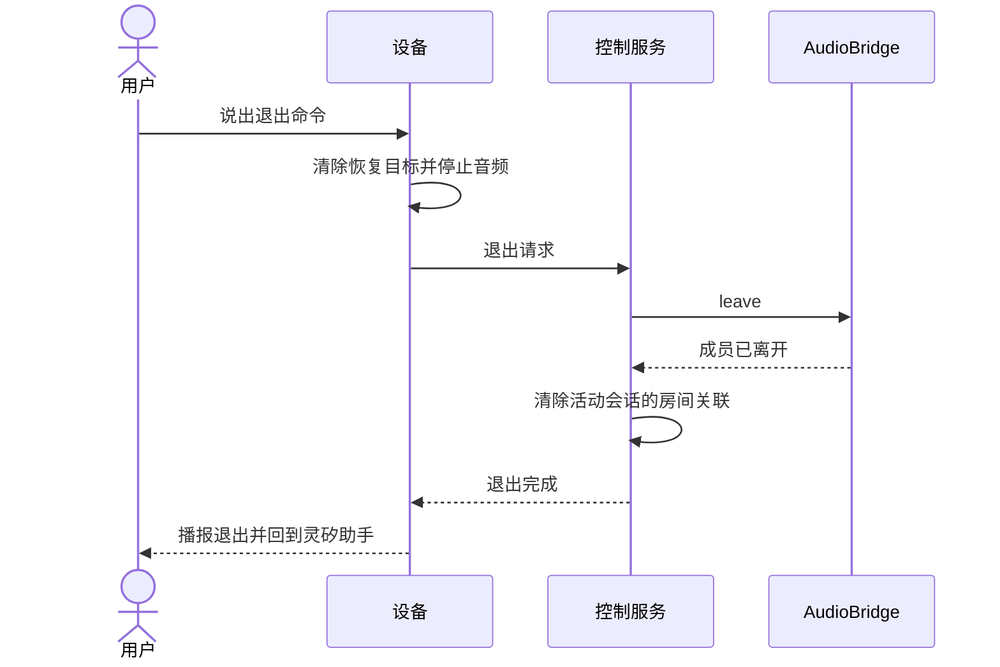
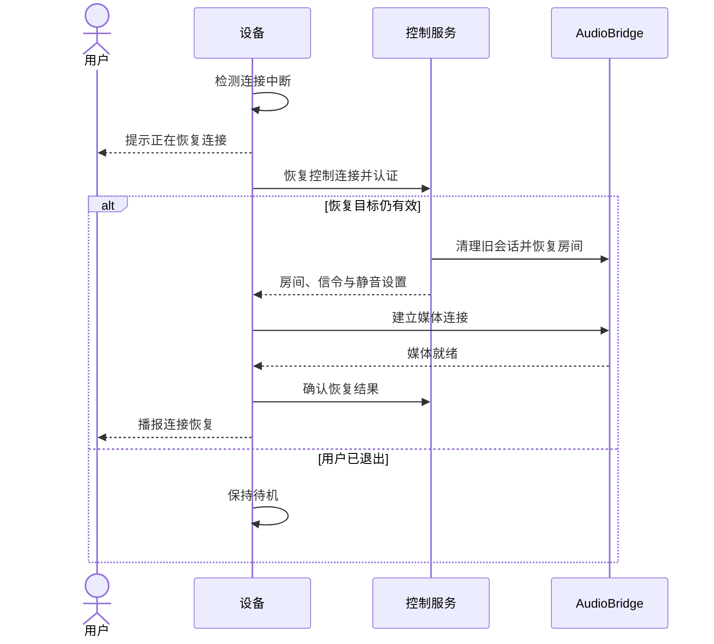

# 产品架构

本文是技术附录，描述同频的组件、连接、状态机、交互时序与关键实现决策。产品定义见 [产品设计](product-design.md)，消息格式见 [控制协议](control-protocol.md)

## 系统架构

设备固件维护两条互相独立的 WebSocket：灵矽平台会话承载 ASR/LLM/TTS 与设备侧 MCP 工具调用，同频控制会话承载房间信令与操作投递。群语音走第三条通道，即设备与 Janus 之间的 WebRTC PeerConnection，AudioBridge 为每位成员混合其余成员的声音。两条控制连接任一中断时另一条继续工作：平台断线时对讲照常，控制通道断线后设备退到灵矽待机并按恢复目标重连

| 组件 | 职责 |
| --- | --- |
| 同频固件 | 音频硬件（INMP441 采集、MAX98357 播放）、唤醒词与按键、灵矽协议适配（OTA/WSS/MCP）、同频控制协议、房间状态机、音频仲裁与本地播报 |
| 控制服务 | 设备认证、房间与邀请码、NFC 入口解析、成员与恢复目标、Janus 信令转发、服务端操作投递（op）、云端 MCP 适配、只读状态接口 |
| Janus AudioBridge | 房间媒体、服务端混音、房间隔离、changeroom |
| 灵矽平台 | OTA 激活与设备 token、设备会话、ASR/LLM/TTS、MCP 工具发现与调用 |
| 浏览器端 | 第二通话端、设备实时状态面板、协议回归测试对象 |

设备固件基于 [ESP-IDF](https://github.com/espressif/esp-idf) 和 [ESP-WebRTC](https://github.com/espressif/esp-webrtc-solution)。上行经过采集、直流阻断高通滤波和 Opus 编码，下行经过解码和播放；音频处理模块预留回声消除接入点，参考信号取实际送往扬声器的 PCM。唤醒词由 esp-sr wakenet 在设备本地检测

## 执行链

### 语音发起的房间操作

设备上有两条语音入口，进入同一条执行链：

1. 按住命令键（BOOT）：固件延迟约 250 ms 向灵矽平台开一轮 `listen`，期间房间上行暂停、收听保持，松开结束收音
2. 唤醒词「你好小智」：命中后自动开一轮 `listen`，平台 TTS 回复结束或 15 秒超时收尾

语音经平台 ASR/LLM 后，智能体调用设备侧 MCP 工具（`self.intercom.create/join/switch/status/set_mute/leave`）。固件收到 `tools/call` 后经统一房间执行器执行：控制协议 `join`/`leave`/`set_mute` → Janus 媒体建立或 `changeroom` → 设备 `confirm` → 返回 MCP 工具结果。智能体拿到含真实房间名、在线数、静音态的回包后用 TTS 播报；`create` 的结果另带邀请码及其中文逐字读法 `invite_spoken`，供智能体念给用户。失败（无效邀请码、未加入的房间名、目标离线）同样经工具结果回报

### 云端接管

设备语音以外的入口投递到设备后汇入同一条执行链：

- 云端 MCP：灵矽智能体或其他 MCP 客户端调用 `intercom.*` 工具，控制服务的 MCP 适配层把工具调用翻译为服务端 `op`，经设备已有的控制会话下投，设备执行后回 `op_result`，再包装为 MCP 工具结果。`POST /admin/op` 是同一投递面的 HTTP 形式
- 平台反向通道：`tools/mcpbridge` 连出平台 `mcpproxy`，把平台侧的 `intercom.*` 调用转成 `/admin/op`
- 浏览器端：`tools/browser` 页面直接操作本端入房、切房、静音，并轮询 `/state` 显示目标设备的实时状态

云端触发的房间变化发生在设备本地时，设备用内置播报片段说明结果（「欢迎进入二号房」「已退出对讲房间」），因为平台 TTS 只送达发起语音的那一端。设备自己用语音触发、智能体 TTS 即将回答时，本地播报让位，只保留提示音

## 数据模型

- **Device**：以固定 MAC 地址作为 `device_id`，保存认证凭据、静音设置和连接恢复目标
- **NFCEntry**：以标签标识作为 `entry_id`，记录入口类型及目标。房间入口指向 `room_id`；设备标签的 UID 预先登记并指向目标设备的 MAC，标签也可直接携带 MAC 内容
- **Room**：保存 `room_id`、系统生成的唯一名称、唯一六位邀请码 `invite_code` 及 Janus 房间映射。名称采用「一号房」「二号房」等编号形式
- **Membership**：保存设备与已加入房间的关系，用于按名称再次进入
- **Session**：维护连接状态、当前房间、目标房间和当前操作的 `request_id`

标签标识与成员关系各自唯一。控制服务优先解析设备标签，其余未登记的 UID 作为房间入口，原子创建标签映射和房间；重复请求返回同一结果。`{"kind":"new"}` 入房目标直接创建房间，其后的入房、确认流程与其他目标一致

设备在媒体就绪后确认当前房间，服务端此时写入恢复目标与已加入记录。切房过程中保留原房间作为失败恢复目标；主动退出清除恢复目标，保留已加入记录。空房间释放媒体资源，再次加入时恢复

## 状态机

静音是独立于会话状态的用户设置。指令处理和切房临时暂停上行，保持静音设置；恢复连接使用最近一次确认的房间。主动退出先清除恢复目标，后续连接事件因此保持待机

### 状态同步

| 状态 | 同步机制 |
| --- | --- |
| 当前房间 | 设备在媒体就绪后 `confirm`，服务端写入恢复目标与已加入记录 |
| 静音 | 持久用户设置，存服务端与设备 NVS；切房后服务端在 Janus 上恢复同一设置 |
| 恢复目标 | 主动退出清除；连接中断保留，重连 `hello` 带回 `resume_room` 自动回房 |
| 操作关联 | 操作携带 `request_id`/`op_id`，设备只应用当前操作的结果，迟到响应无法覆盖新状态 |
| 状态查询 | `GET /state?device_id=` 只读返回在线设备的模式、房间、邀请码、静音、人数 |

## 交互时序

### 组队

控制服务把新建请求、NFC 入口或邀请码解析为目标房间，按名称加入时查询设备的已加入记录。控制服务协调 SDP 和 ICE，设备与语音房间建立媒体连接；媒体就绪后提交成员状态并返回结果

目标设备离线、入口解析失败或语音目标无效时，控制服务返回对应错误，设备保持原会话状态。对同一入口的重复接触由设备去重，服务端按请求 ID 保证幂等

### 通话

上行和下行同时进行，AudioBridge 为每位接收者混合其他成员的声音。房间内的命令经灵矽会话处理，查询返回当前房间名称、在线人数和邀请码，由智能体播报

### 房间切换

控制服务按名称查询设备已加入的房间，或按邀请码、NFC 入口解析目标，使用 AudioBridge 的 `changeroom` 切换。设备沿用媒体连接，清理原房间的播放缓冲，并恢复用户的静音设置

### 退出

设备先清除恢复目标并停止音频，再结束服务端会话。已加入记录保留，用于后续按名称再次进入

控制连接中断时，设备仍执行本地退出；服务端在会话失效后回收对应媒体资源

### 连接恢复

设备保存最近一次确认的房间和静音设置。连接恢复时重新认证、协调媒体连接，音频就绪后恢复通话

## 平台会话容错

平台 WebSocket 有三类失效，各用一种判据：

| 失效 | 判据与处理 |
| --- | --- |
| 正常断开 | `DISCONNECTED` 事件触发 5 秒后重连 |
| 半开 TCP，对端静默消失 | 发送失败且底层 socket 已断时立即标记会话下线并重连，后续发送短路返回 |
| 会话内逻辑僵死，TTS 回合无 stop | 应用层看门狗：首帧 25 s、帧间 5 s，超时只复位本回合的播放让位与回复等待状态，迟到的 TTS 事件无法污染新回合 |

## 实现决策

| 决策 | 依据 |
| --- | --- |
| 设备同时持有灵矽会话与同频控制会话 | 平台抖动、重连、会话重建都不影响房内通话；控制通道独立保证房间状态一致 |
| 设备作 MCP 工具服务端 | 工具发现随设备会话完成，执行结果回到同一轮对话；语音入口与其他入口共用执行器 |
| 工具结果在媒体确认后返回 | 回包携带已验证的房间名、在线数、静音态；长操作由超时与可查询状态兜底 |
| 本地播报片段 + 播放仲裁 | 云端、NFC、召唤、恢复入房时平台 TTS 不落在本机，由设备内置 Opus 片段播报；设备语音触发时让位给智能体回复 |
| 单一播放调度器 + 音源仲裁 | 灵矽 TTS、房间下行、提示音、播报片段进同一条解码播放链；状态切换时清空旧缓冲并复位解码器，迟到音频无法混入新模式 |
| 播放调度邮槽（seqlock 世代） | 播报序列由 app 任务发布、播放任务持有游标；清空时发布空代退役旧游标，取帧零拷贝 |
| TTS 抖动缓冲 150 帧 + 欠载重蓄势 | 平台 TTS 按句突发下发，句间停顿可达秒级；欠载后先积约 800 ms 再放音，句间停顿听感连续 |
| 智能体回复期间房间上行发静音帧 | 外放的智能体回复经麦克风回采时不会传进房间 |
| 静音时上行周期发静音帧 | Janus keepalive 保持静音成员的媒体连接 |

## 设备身份与平台绑定

设备以固定 `Device-Id`/`Client-Id` 经平台 OTA 接口获取激活码，账号侧绑定后 OTA 返回设备 token 与 WebSocket 地址，固件凭 token 建立带 `features.mcp` 的设备会话。演示使用的虚拟身份经激活码绑定在目标智能体下，物理 MAC 只用于同频控制服务识别设备；换绑身份只需改配置重新激活

## 注入式测试路径

每条用户可达路径都保留一条无需语音或硬件的注入入口，注入经由同一执行代码：

| 真实路径 | 注入路径 | 覆盖 |
| --- | --- | --- |
| 语音指令 → 智能体 → 工具 → TTS | sdkconfig `INTERCOM_LINX_SELFTEST_TEXT` 每次会话自动发 `listen.detect` | 会话、智能体、工具、TTS、外放全链 |
| NFC 触碰入房 | `POST /admin/op {"op":"nfc","arg":"<标签UID>"}` | 标签解析、入房执行、确认、播报 |
| 设备灵矽会话 | 软设备 `softdev -script` 文本脚本 | 平台会话、工具回包、状态断言 |
| 房间通话对端 | `tools/browser` 浏览器端、`wsprobe` 协议探针 | 真实 Janus 媒体收发 |

拾音与唤醒质量由真机人工验收，协议、状态机与平台集成在无硬件环境下持续回归
