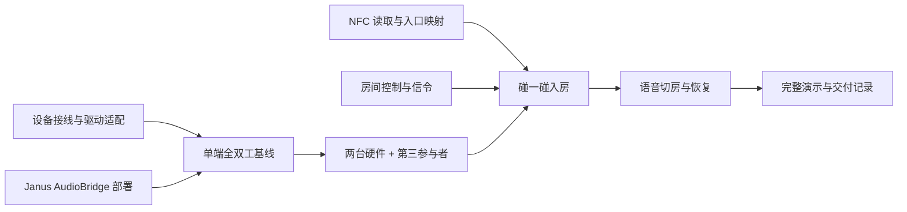

# 灵矽同频：实施方案

状态：执行草案。产品行为与架构以[产品与架构设计](product-design.md)的评审结果为准。本文定义代码组织、开发顺序与验收方法

## 1. 交付目标

交付两台能够通过 NFC 入房、进行全双工通话并通过语音切房的设备，以及配套房间控制与音频服务

- X-Atom 样机使用 4G 和电池，作为移动演示终端
- ESP32 面包板使用 Wi-Fi 和 USB 供电，作为第二个硬件终端；移动测试使用手机热点与移动电源
- 电脑浏览器作为调试对端和第三位参与者，验证多人混音

## 2. 代码与部署分工

### 2.1 firmware：设备固件

从 ESP-IDF 新工程建立以下模块：

- **board**：两种板型的音频引脚、供电和外设适配；记录主控目标、Flash、PSRAM 与接线
- **audio**：采集、回声消除、降噪、Opus 编解码、播放和提示音
- **network / rtc**：Wi-Fi、4G、ESP-WebRTC 连接、音频发送接收与重连
- **nfc**：读取标签 UID 或 MAC 内容，消除重复触碰，提交入口事件
- **control**：房间状态、固定语音命令、静音偏好和切房事务

固件接入控制服务的 WSS 通道，通过控制服务协调 Janus AudioBridge 信令。音频直接使用 WebRTC 媒体路径

### 2.2 server：房间控制服务

计划使用 Go 单实例服务，SQLite 保存设备、入口、房间和成员关系；在线会话与请求状态放在运行时内存

- 设备身份认证和连接登记
- NFC 入口解析、临时房间创建、设备标签解析和入房幂等
- 房间列表、加入、退出和切换
- Janus 会话、插件句柄、SDP/ICE 信令协调及连接保活
- 成员状态事件和可播报的操作结果

实现 AudioBridge 适配时，覆盖 create、join、configure、changeroom、leave 及相应异步事件。控制消息携带请求 ID，设备仅将当前请求的结果应用到活动状态

### 2.3 infra：音频服务与部署

在公网 Linux 节点部署 Janus AudioBridge、控制服务和 TURN。配置包括 TLS、域名、媒体端口、TURN 凭据、持久化目录和健康检查

配置模板与密钥分离。仓库保存示例配置，运行环境注入实际设备凭据和服务密钥。组件版本在首条音频链路跑通后固定到部署配置

## 3. 开发依赖与里程碑

### M0：建立设备与云端基础

工作：记录两台设备的器件和接线，新建固件工程，完成采音与播放；部署 Janus，并用浏览器验证 AudioBridge 房间

产出：板型记录、固件构建入口、Janus 配置、浏览器测试房间。记录实际固件目标、服务版本和连接地址

### M1：面包板与浏览器全双工

工作：面包板通过 Wi-Fi 接入 AudioBridge，完成 Opus 上下行及回声消除；固定一个测试房间

验收：两端同时说不同短句，各自能听清对方；一端播放声音时，另一端听到的回传保持正常，记录回声与音量调试结果

### M2：两台硬件与多人混音

工作：适配 X-Atom 的音频与 4G，接入同一房间；浏览器作为第三位参与者

验收：两台真实硬件完成同时说话和收听；三方同时发话时，每位参与者能听到另外两位。设备发送和接收各维持一路音频，记录实际 CPU、内存、网络及音频表现

### M3：NFC 组队闭环

工作：实现入口映射和入房状态，准备两张房间贴纸与两张设备标签

验收：

- 两台设备扫描同一房间贴纸后进入同一房间，链路就绪后播报成功
- 扫描在线待机设备的标签时，创建临时房间并让双方加入
- 扫描正在通话设备的标签时，扫描者加入目标设备当前房间
- 持续贴住标签或重复上报同一请求时，保持同一房间及成员关系
- 目标设备离线或标签入口解析失败时，播报结果并保留原通话状态

### M4：语音切房、静音与恢复

工作：接入固定语音命令，完成切房事务、提示音、静音偏好和网络重连

验收：

- 说“切到二队”后，设备暂停上行，切房成功并播报，再恢复目标房间通话
- 旧房间与目标房间各保留一个测试参与者，验证切换后的声音准确送达目标房间，旧房间停止收到该设备的新音频
- 目标房间切换失败时，恢复原房间并播报结果
- “静音”“恢复通话”“当前房间”“退出房间”产生对应状态和提示
- 断开并恢复网络后，设备恢复最近活动房间及静音偏好；用户主动退出时保持待机

## 4. 两天的工作安排

**第一天优先交付音频链路。** 完成 M0、M1，并推进 X-Atom 4G 接入；NFC 读卡和房间服务可以并行开发。以实际收发声音作为当日集成依据

**第二天交付组队与切房体验。** 完成 M2、M3、M4，保留完整演示和网络恢复测试时间。先稳定两台硬件的通话，再接入第三参与者验证群聊

工程问题沿对应模块处理：音频问题定位到采集、播放、回声消除与编解码；入房问题定位到设备控制、信令和房间状态；4G 问题记录连接事件、网络路径及重连过程

## 5. 物料与开发记录

现有两台设备作为全部硬件终端。NFC 准备房间贴纸、设备标签及各端读卡组件；贴纸采用 NTAG213，贴金属表面时使用抗金属版本

开发时逐步补充以下记录：

- 每台设备的主控、音频器件、4G 模块、NFC 接线与供电方式
- 构建、烧录、日志读取命令及实际验证的软件版本
- 每次验证使用的设备、网络、房间和源码提交
- 观测到的延迟、回声、断续、内存与重连现象，以及对应处理结果

## 6. 演示与交付

演示按以下顺序进行：

1. 两台设备碰“一队”贴纸，播报入房结果
2. 两位使用者同时说话，展示全双工
3. 浏览器第三位参与者加入，展示多人混音
4. 一台设备通过语音切到“二队”，与目标房间参与者通话
5. 通过 NFC 回到“一队”，继续原房间通话

交付包含两种板型的固件产物、控制服务、部署配置、接线与操作说明，以及可追溯的验证记录。仓库中的运行说明随各里程碑完成更新
