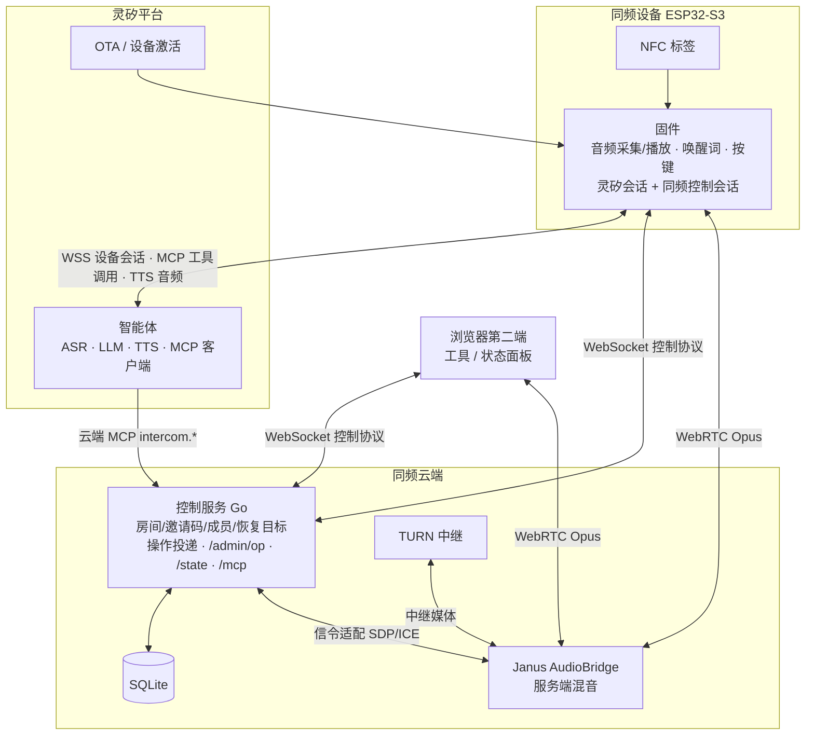

# 灵矽同频 产品设计

## 产品定义

灵矽同频是一套接入灵矽平台的群语音对讲系统：一台 ESP32-S3 设备承载灵矽智能体对话，用户用语音、按键或 NFC 让设备进入一个编号对讲房间，房间内多名成员全双工通话，退出后设备回到灵矽对话。

面向的场合是双手与视线被占用时的即时群沟通：共同行程中的路况与集合、现场协作中的分工确认、以及任何需要「按住就说、全员听见」的群体场景。

产品形态由三部分组成：

| 形态 | 说明 |
| --- | --- |
| 同频设备 | ESP32-S3 面包板固件，同时保持灵矽平台会话与同频控制会话；承载智能体对话、对讲收发、按键与唤醒、本地播报 |
| 同频云端 | Go 控制服务（房间、邀请码、成员、恢复目标、操作投递）+ Janus AudioBridge（服务端混音）+ TURN 中继 |
| 浏览器第二端 | 同一份控制协议的 Web 客户端，作房间对端、设备状态面板与开发联调工具 |

房间是持久实体：系统分配唯一编号名称（一号房、二号房……）与六位数字邀请码，两者一经创建保持不变。设备记住已加入过的房间，可以按名称切回；邀请码用于首次进入他人房间。

## 系统架构

设备固件维护两条互相独立的 WebSocket：灵矽平台会话承载 ASR/LLM/TTS 与设备侧 MCP 工具调用；同频控制会话承载房间信令与操作投递。群语音走第三条通道——设备与 Janus 之间的 WebRTC PeerConnection，AudioBridge 为每位成员混合其余成员的声音。两条控制连接任一中断时另一条继续工作：平台断线不打断对讲，控制通道断线后设备退到灵矽待机并按恢复目标重连。

| 组件 | 职责 |
| --- | --- |
| 同频固件 | 音频硬件（INMP441 采集、MAX98357 播放）、唤醒词与按键、灵矽协议适配（OTA/WSS/MCP）、同频控制协议、房间状态机、音频仲裁与本地播报 |
| 控制服务 | 设备认证、房间与邀请码、NFC 入口解析、成员与恢复目标、Janus 信令转发、服务端主动操作投递（op）、云端 MCP 适配、只读状态接口 |
| Janus AudioBridge | 房间媒体、服务端混音、房间隔离、changeroom |
| 灵矽平台 | OTA 激活与设备 token、设备会话、ASR/LLM/TTS、MCP 工具发现与调用 |
| 浏览器端 | 联调用第二通话端、设备实时状态显示、协议回归测试对象 |

## 核心流程

### 语音操作房间

设备上发起房间操作有两条语音入口，进入同一条执行链：

1. 按住命令键（BOOT）：固件延迟约 250 ms 向灵矽平台开一轮 `listen`，期间房间上行暂停、收听保持；松开结束收音。
2. 唤醒词「你好小智」：命中后自动开一轮 `listen`，平台 TTS 回复结束或 15 秒超时收尾。

语音经平台 ASR/LLM 后，智能体调用设备侧 MCP 工具（`self.intercom.join/switch/status/set_mute/leave`）。固件收到 `tools/call` 后走统一房间执行器：控制协议 `join`/`leave`/`set_mute` → Janus 媒体建立或 `changeroom` → 设备 `confirm` → 此时才回 MCP 工具结果。智能体拿到含真实房间名、邀请码、在线数、静音态的回包后用 TTS 播报，播报内容与设备实际状态一致。失败（无效邀请码、未加入的房间名、目标离线）同样经工具结果如实回报。

### 云端接管

不经过设备语音的入口有两条，投递到设备后走同一条执行链：

- 云端 MCP：灵矽智能体或其他 MCP 客户端调用 `intercom.*` 工具，控制服务的 MCP 适配层把工具调用翻译为服务端 `op` 下投到目标设备（`POST /admin/op` 是同一投递面的 HTTP 形式，供脚本与管理用）。
- 浏览器第二端：`tools/browser` 页面直接操作本端入房/切房/静音，并轮询 `/state` 显示目标设备的实时房间状态。

云端触发的房间变化发生在设备本地时，设备用内置播报片段播报结果（「已进入二号房」、逐位邀请码、「已退出对讲房间」），因为平台 TTS 只送达发起语音的那一端。设备自己刚用语音触发、智能体 TTS 即将回答时，本地播报告让位，避免重复出声。

### 状态同步

| 状态 | 同步机制 |
| --- | --- |
| 当前房间 | 设备在媒体就绪后 `confirm`，服务端写入恢复目标与已加入记录 |
| 静音 | 持久用户设置，存服务端与设备 NVS；切房后服务端在 Janus 上恢复同一设置 |
| 恢复目标 | 主动退出清除；连接中断保留，重连 `hello` 带回 `resume_room` 自动回房 |
| 会话生命周期 | 操作携带 `request_id`/`op_id`，设备只应用当前操作的结果，迟到响应无法覆盖新状态 |
| 状态查询 | `GET /state?device_id=` 只读返回在线设备的模式/房间/邀请码/静音/人数 |

### 断线与僵死恢复

平台会话僵死（半开 TCP）不发 `DISCONNECTED` 事件、发送全失败的场景：发送路径检测到 socket 已断时立即标记会话下线，触发 5 秒重连，后续发送短路。平台 TTS 回合由看门狗约束（首帧 25 s、帧间 5 s），超时恢复播放让位与回复等待状态，迟到的 TTS 事件无法污染新回合。

## 设计决策与依据

| 决策 | 依据 |
| --- | --- |
| 设备同时持有灵矽会话与同频控制会话 | 平台会话生命周期与房间业务解耦：平台抖动、重连、会话重建都不波及房内通话；控制通道独立保证房间状态一致 |
| 设备作 MCP 工具服务端，智能体经工具调用操作房间 | 平台原生入口：工具发现随会话完成，设备上的执行结果回到同一轮对话，智能体如实播报；语音入口与其他入口共用执行器 |
| 工具结果在媒体确认后返回 | 回包携带的是已验证状态（房间名/邀请码/在线数/静音态），智能体说出的内容就是设备真实状态；长操作由超时与可查询状态兜底 |
| 本地播报片段 + 播放仲裁 | 云端/NFC/召唤/恢复入房没有平台 TTS 落在本机，设备内置 Opus 片段播报房间名与结果；设备语音触发时让位给智能体回复 |
| 房间名/邀请码持久化，名称编号化 | 房间长期复用；编号房间名（一号房）与逐位数字邀请码都能被语音准确说出、被本地短音频拼接播报 |
| 静音是用户设置而非会话状态 | 切房、恢复、接管后静音保持；静音时上行周期发静音帧，Janus keepalive 不会挂断静音腿 |
| 单一播放调度器 + 音源仲裁 | 灵矽 TTS、房间下行、提示音、播报片段进同一条解码-播放链；状态切换 flush 旧缓冲并复位解码器，迟到音频无法混入新模式 |
| 播放调度邮槽（seqlock 世代） | 播报序列由 app 任务发布、播放任务持有游标；flush 发布空代退役旧游标，取帧零拷贝，消除双槽 volatile 的生命周期竞态 |
| 抖动缓冲 150 帧 + 欠载重蓄势 | 平台 TTS 按句子突发下发、句间停顿可达秒级；欠载后先积约 500 ms 跑道再放音，句间停顿听感自然而非断音 |
| 发送失败即判会话下线 | 半开 TCP 不产生断连事件；以「send 失败且 socket 已断」为僵死判据，立即标记下线走重连，止住向死连接的刷屏发送 |

## 可迁移模式

以下模式在本项目中经过真机与真实平台验证，可直接迁移到灵矽/XAtom 类「设备 + 平台智能体 + 自有业务面」项目：

### 设备-智能体绑定

设备以固定 `Device-Id`/`Client-Id` 走平台 OTA 接口换取激活码，账号侧绑定后 OTA 返回设备 token 与 WebSocket 地址，固件凭 token 建立带 `features.mcp` 的设备会话。要点：设备身份与物理 MAC 解耦——演示用的 `02:e6:...` 虚拟身份经激活码绑定在目标智能体下，物理 MAC 的归属校验由服务端单独处理；换绑身份只需改配置重激活。工具结果文本中附带可被智能体直接读出的结构化状态（`{"ok":true,"mode":"intercom","room":"二号房",...}`），使智能体回复天然与设备一致。

### MCP 工具桥

同一组房间操作暴露两次：设备侧 `self.intercom.*`（平台→设备）与云端 `intercom.*`（任意 MCP 客户端→控制服务→设备）。云端侧的实现模式：MCP/SSE 适配层把 `tools/call` 译为服务端 `op` 帧，经设备既有的控制会话下投，设备执行后回 `op_result`，再包装为 MCP 工具结果。平台官方反向通道（mcpproxy connect）用独立桥进程把同一组工具接到平台侧。新增业务时只在执行器加一条命令，两侧工具描述同步即可。

### 平台会话生命周期容错

平台 WebSocket 的三类失效需要分别的判据：正常断开走 `DISCONNECTED` 事件重连；半开 TCP（对端静默消失）靠发送失败 + `is_connected` 检查立即标记下线；会话内的逻辑僵死（TTS 回合无 stop、回复永远不来）靠应用层看门狗——首帧与帧间各设上限，超时只复位本回合状态位。重连用有界退避；发送路径在连接标记下线后短路返回，避免错误风暴。

### 注入式测试路径

每条用户可达路径都留了一条无需语音/硬件的注入入口，注入走同一执行代码：

| 真实路径 | 注入路径 | 覆盖 |
| --- | --- | --- |
| 按住说话→ASR→工具调用 | sdkconfig `INTERCOM_LINX_SELFTEST_TEXT` 每会话自动发 `listen.detect` | 会话→智能体→工具→TTS→外放全链 |
| NFC 触碰入房 | `POST /admin/op {"op":"join","arg":...}` | 房间解析→媒体→确认→播报 |
| 设备按键/唤醒 | 软设备 `softdev -script` 文本脚本 | 平台会话、工具回包、状态断言 |
| 房间通话对端 | `tools/browser` 浏览器端、`wsprobe` 协议探针 | 真实 Janus 媒体收发 |

注入测试的价值在于把「全链路是否通」与「拾音/唤醒是否好」分开验证：夜间或无硬件环境下仍能持续回归协议、状态机与平台集成。

## 展望

| 方向 | 入口 |
| --- | --- |
| NFC 物理读卡器接回固件 | 服务端入口与组队语义已就绪，`/admin/op` 注入已覆盖同一代码路径 |
| AEC 回声消除 | 播放参考信号路径已规划，板级音频管线可直接接入 |
| App 设备页 | 展示同频状态与邀请码，沿用灵矽 App 设备绑定与智能体 MCP 配置 |
| 多端多板型 | 协议、音频模式管理与板级配置已分离；固件版本与 OTA 发布流程随后建立 |
| 云端 MCP 公网接入 | 服务认证与默认目标选择完善后，开放给其他 MCP 客户端 |
