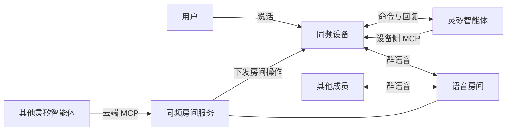

# 灵矽同频 产品设计

## 定位

灵矽平台上，设备和智能体之间是一对一的对话。灵矽同频给平台加上多人实时语音房间：用户对设备说一句话就能新建房间、用邀请码加入、按名字切换，房间成员之间全双工通话；其他灵矽智能体也能通过云端工具把设备拉进房间。首要用户是开车等双手和视线被占用、又需要随时和一群人说话的人

交付物分三部分：

| 部分 | 内容 |
| --- | --- |
| 房间服务 | 房间、邀请码、成员、恢复目标，群语音混音 |
| MCP 工具 | 设备侧 `self.intercom.*` 与云端 `intercom.*` 两套，操作语义相同 |
| 参考固件 | ESP32-S3，同时接入灵矽平台与房间服务 |

## 扩展灵矽的方式

智能体负责控制：听懂用户要做什么，调用房间工具，把结果说出来。房间服务负责媒体：设备经 WebRTC 连到语音房间，由 Janus AudioBridge 在服务端混音。智能体链路只承载命令，通话的延迟和平台调用成本与通话时长无关

同频经灵矽已有的三个扩展点接入，平台侧零改动：

| 扩展点 | 调用方 | 作用 |
| --- | --- | --- |
| 设备侧 MCP `self.intercom.*` | 设备绑定的智能体 | 用户对设备说话，智能体操作这台设备的房间 |
| 云端 MCP `intercom.*` | 配置了同频服务的任意灵矽智能体或 MCP 客户端 | 远程让指定设备入房、切房、静音、退出 |
| mcpproxy 反向通道 | 灵矽平台 | 同频服务主动连出并注册云端工具，部署时无需公网入口 |

设备身份、OTA 激活、账号绑定和 ASR/LLM/TTS 沿用平台现有流程。两套工具落到设备上同一个房间执行器，新增一项房间能力只需在执行器加一条命令并同步两侧工具描述，语音新建房间就是按这条路径加上的

## 交互：一台设备，两路对话

设备默认是普通的灵矽助手。进入房间后切到对讲模式，同时承载两路对话：

| 动作 | 对讲模式下谁听到 |
| --- | --- |
| 直接开口 | 房间全员 |
| 按住 BOOT 说话，或说唤醒词「你好小智」 | 只有智能体；房间上行暂停，房间声音继续播放 |
| 智能体回复 | 只在本机播放，房间上行此时发静音帧 |
| 双击 BOOT | 切换静音，静音时继续收听 |

跟队友说话零操作，跟智能体说话才需要按键或唤醒。开车时最频繁的动作是和队友说话，放在零操作一侧；对智能体的命令频率低，用明确的触发防止误操作

开麦设计面向成员较少的房间。设备外放时需要回声消除才能让双方同时说话而不回授，固件已预留接入点，当前演示由对端佩戴耳机。成员多的大房间适合按键通话，列为后续模式

## 房间与建群

房间是持久对象。系统按顺序起名「一号房」「二号房」……并分配六位数字邀请码，两者创建后不变。编号名和逐位数字都容易说清、也容易被语音识别听准

两种标识对应两种权限：

- 邀请码是首次进入的凭证，只告诉要拉进来的人
- 房间名只用于切回自己加入过的房间，可以随口说出，只知道房间名的人无法进入

进入房间的方式：

| 入口 | 做法 | 结果 |
| --- | --- | --- |
| 语音新建 | 「新建一个对讲房间」 | 建房并入房，智能体念出房间名和邀请码，用户转告队友 |
| 邀请码 | 「加入对讲房间，邀请码七二三八二七」 | 首次进入别人的房间 |
| 房间名 | 「切换到二号房」 | 回到加入过的房间，静音设置保留；切换失败时留在原房间 |
| NFC 房间标签 | 设备碰标签 | 第一次碰建房并绑定标签，之后碰进入同一房间 |
| NFC 设备标签 | 两台设备相碰 | 对方在房间里则加入对方；对方待机则新建房间并召唤双方 |
| 云端调用 | 另一个灵矽智能体调用 `intercom.*` | 远程让设备入房、切房、退出 |
| 自动恢复 | 断线或断电重启 | 回到最后确认的房间；主动退出后保持待机 |

## 反馈：语音就是界面

用户全程看不到屏幕，每次操作的语音反馈必须和设备真实状态一致：

- 工具调用在语音媒体接通、服务端确认之后才返回，智能体说出的房间名和在线人数就是设备实际所在的房间。失败时说明原因：邀请码无效、没加入过该房间、目标设备离线
- 云端调用、NFC、召唤、自动恢复这类远程触发改变了房间时，设备用本地提示音和播报说明结果，因为平台 TTS 只回到发起操作的那一端。用户自己用语音触发时，本地播报让位给智能体的回答
- 静音是持久设置，切房、恢复、重启后保持

## 完成度

| 能力 | 状态 |
| --- | --- |
| 语音新建、加入、切换、查询、静音、退出 | 真机与真实灵矽平台实测 |
| 云端智能体接管设备 | 真实灵矽平台经 mcpproxy 调用，真机执行 |
| 断线、重启自动回房 | 真机实测，单成员房间连续 30 分钟保持 |
| NFC 两类标签 | 服务端与固件执行链完成，经 `op:nfc` 注入验证；读卡器待接 |
| 第二台同频设备 | 由浏览器端代替，使用同一控制协议 |
| 回声消除 | 待接入 |

## 后续方向

| 方向 | 说明 |
| --- | --- |
| NFC 读卡器 | 接入后两类标签直接走已完成的执行链 |
| 回声消除 | 播放参考取送往扬声器的 PCM |
| 按键通话模式 | 面向成员较多的房间 |
| 按名称指定目标设备 | 调用方说「把三号车拉进二号房」，云端工具按设备别名解析目标 |
| 灵矽 App 设备页 | 显示房间与邀请码，沿用 App 现有的设备绑定和智能体 MCP 配置 |
| 多板型 | 协议、音频模式与板级配置已分离，按板型移植 |

技术实现见 [产品架构](architecture-design.md)，消息格式见 [控制协议](control-protocol.md)，操作与部署见 [使用说明](usage.md)
