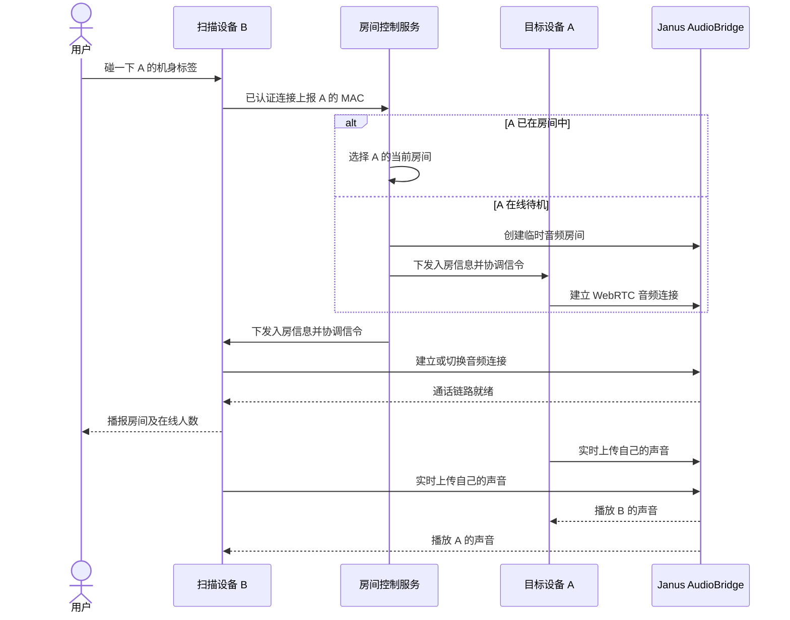
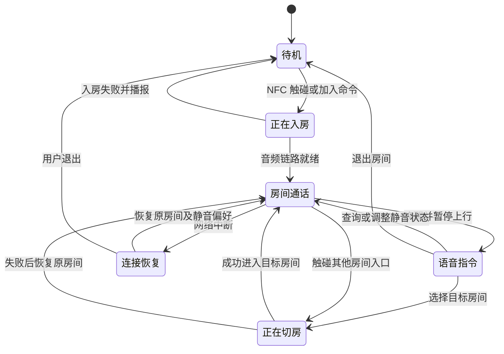
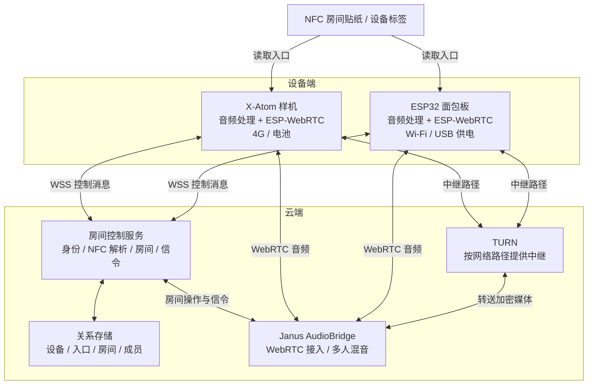
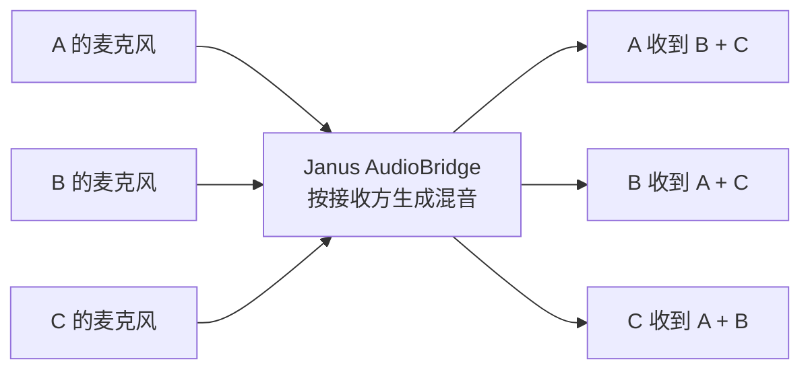

# 灵矽同频：产品与架构设计

状态：待评审。本文用于评审产品行为与架构选择；开发阶段和验证方法见[实施方案](implementation-plan.md)

## 1. 产品目标与使用场景

灵矽同频让司机通过无屏设备与同行者保持实时语音联系。出发前碰 NFC 标签完成组队，行程中直接交谈，通过短语音命令切换房间、静音或退出

核心体验：触碰入房、成功提示、全双工交谈、语音切房

- **真人全双工通话**：每位成员可以同时说话和收听，支持自然插话
- **硬件直接组队**：房间贴纸和设备机身标签都是入房入口
- **一个当前房间**：设备保存已经加入的房间，当前通话聚焦其中一个
- **无屏状态反馈**：入房、切房、退出及网络状态通过提示音和短语音表达

语音识别处理设备命令；真人声音通过音频链路传输。状态播报使用预录音或独立 TTS

## 2. NFC 入口与房间规则

### 2.1 两类入口

**房间贴纸**对应固定房间。服务端将标签 UID 映射到房间 ID，首次读取可以创建映射；后续扫描者进入同一房间。贴纸可以放在集合点、车队装备或设备外壳上

**设备标签**对应一个设备的固定 MAC 地址。扫描者进入目标设备的当前房间；目标设备在线待机时，服务端创建临时房间并通知双方加入。机身标签采用可读取的 MAC 内容，或采用标签 UID 到 MAC 的预登记映射

两台设备“碰一碰”的首版交互，就是一台读取另一台机身上的标签。固件统一提交入口标识，由服务端解析目的房间

### 2.2 触碰后的行为

- 扫描房间贴纸：加入该贴纸对应房间
- 扫描在线且正在通话的设备：加入该设备当前房间，扫描者原房间的其他成员继续通话
- 扫描在线待机的设备：创建临时房间，双方加入
- 扫描当前房间的入口：播报当前房间，保持现有连接
- 目标设备离线或入口解析失败：播报原因，保持扫描者当前通话状态

设备对一次持续接触做去重，服务端对同一入房请求做幂等处理。触碰代表加入并开启通话的操作意图；设备已有静音偏好时继续保持静音并播报

### 2.3 房间生命周期

房间具有稳定 ID 和可播报的短名称，设备保存已加入房间。演示使用“一队”“二队”等短名称

- 入房成功后，设备更新当前房间并播报名称和人数
- 退出结束当前通话，保留房间记录以便再次加入
- 全部成员离开后，服务端释放音频资源，保留房间与标签映射
- 再次触碰原标签时，服务端恢复对应音频房间

## 3. 无屏操作与状态

### 3.1 通话与语音命令

入房后持续进行全双工通话。语音活动检测用于静音抑制，成员可以随时插话

固定命令包括“切到一队”“切到二队”“当前房间”“静音”“恢复通话”“退出房间”。唤醒后设备进入指令模式，暂停麦克风上行；完成识别、操作和提示后，按当前静音偏好恢复通话

切房时先暂停上行并协调媒体端静音，完成房间切换后清理旧播放缓冲，再恢复当前房间的音频。切房失败时恢复原房间，并说明结果

### 3.2 状态转换

静音是通话状态上的独立属性。网络中断时设备提示连接恢复中；重新联网后恢复最近的活动房间及静音偏好。移动网络覆盖决定户外通话的可用范围

## 4. 系统架构

### 4.1 技术角色与选型

- **WebRTC**：实时音频通信的标准与技术体系，提供连接协商、加密传输和网络穿透机制
- **ESP-WebRTC Solution**：设备端组件集合，组合 PeerConnection、采集、编解码、播放和信令接口，作为 ESP-IDF 固件的通信基础
- **LiveKit**：房间平台、SFU 服务和客户端 SDK。默认将参与者音轨分别转发，终端承担订阅、解码与混音，或由服务端扩展音频合成
- **Janus AudioBridge**：语音会议混音服务，给每台设备发送一路由其他成员声音组成的音频

本项目选择 **ESP-IDF + ESP-WebRTC + Janus AudioBridge**。混音放在服务器，每台设备维持一路编码上行、一路解码下行和一个 WebRTC PeerConnection

### 4.2 控制与音频路径

控制服务处理设备身份、入口解析、房间关系及 Janus 信令协调。媒体路径连接设备与 Janus，TURN 在网络路径需要中继时转送媒体

### 4.3 全双工与混音

设备上行依次经过麦克风采集、回声消除、降噪和 Opus 编码；下行经过 Opus 解码和扬声器播放。扬声器播放信号同时作为回声消除的参考，覆盖队友声音与设备提示音

服务端混音处理多位成员同时发话。成员增加时，单台设备继续处理一路上行与一路下行，服务器承担混音和输出编码的增长

### 4.4 数据与状态归属

- **Device**：固定 MAC 作为设备 ID，保存设备凭据及最近房间。MAC 用于定位，设备凭据用于认证
- **NFCEntry**：记录入口类型和目标。房间入口指向房间 ID，设备入口指向设备 MAC
- **Room**：保存稳定 ID、播报名称和音频房间映射
- **Membership**：保存设备已加入的房间，支持语音再次进入
- **Session**：维护在线连接、当前活动房间、静音偏好和正在执行的入房请求

房间关系和入口映射持久化保存。连接与音频状态由设备、控制服务和 Janus 共同维护，入房成功提示以音频链路就绪为依据

## 5. 本轮评审决策

- NFC 触碰直接表达入房意图，入房后开启全双工通话，并继承设备静音偏好
- 房间贴纸提供稳定入口，设备标签跟随目标设备的当前房间
- 设备同时活动于一个房间，切换失败时恢复原通话
- 采用服务端混音，每台设备处理一路上行与一路下行

## 6. 技术依据

- [ESP-WebRTC Solution](https://github.com/espressif/esp-webrtc-solution)：设备端实时通信组件与示例
- [ESP-WebRTC Janus 示例](https://github.com/espressif/esp-webrtc-solution/tree/main/solutions/janus_demo)：现有示例使用 VideoRoom，本项目实现 AudioBridge 信令适配
- [Janus AudioBridge](https://janus.conf.meetecho.com/docs/audiobridge.html)：音频混音、动态房间、静音与 changeroom 操作
- [LiveKit ESP32 SDK](https://github.com/livekit/client-sdk-esp32)：ESP32 双向音频 SDK 和房间平台方案
